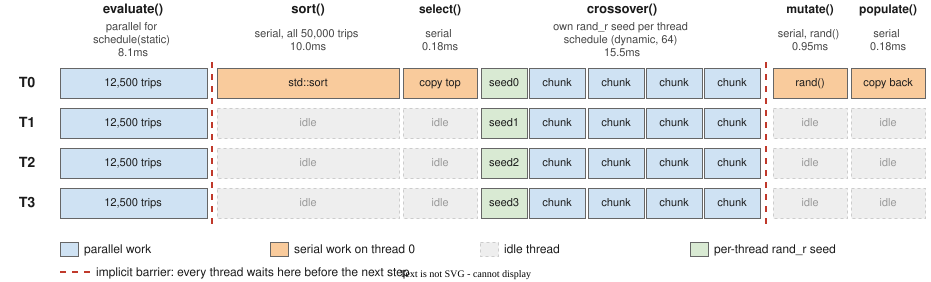

---
format:
  pdf:
    documentclass: article
    papersize: letter
    fontsize: 12pt
    geometry:
      - margin=1in
    include-in-header: preamble.tex
filters:
  - path: ../../templates/writeup/whole-ref-links.lua
    at: post-quarto
  - path: ../../templates/writeup/drawio-svg.lua
    at: pre-quarto
---

```{=latex}
% Fill these in once per assignment. They feed the first-page block,
% the running header (page 2 onward), and the footer.
% Name, last name, ID, and email are NOT set here. scripts/build-writeup.sh
% injects them at build time from .local/student.env, so they stay out of git.
\newcommand{\courseName}{CSS 534: Parallel Programming in Grid and Cloud}
\newcommand{\dueDate}{October 19, 2026}
\newcommand{\asgTitle}{Program 1: Parallelizing TSP with OpenMP}
\newcommand{\codeRepo}{\url{https://github.com/GameAnimeCode/css534-parallel-programming}}

\thispagestyle{firstpage}
\noindent \stuName \hfill \courseName \\
\stuId{} | \stuEmail \hfill \dueDate

\bigskip
\begin{center}
{\Large\bfseries \asgTitle}
\end{center}
```

## 0. Abstract

> The Genetic Algorithm x Traveling Salesman Problem program evolves 50,000 trips through 36 cities for 150 generations. I implemented `evaluate()`, `crossover()` and `mutate()`, then parallelized the two loops that dominate the run time: the distance loop in `evaluate()` and the greedy `crossover()`. On CSSMPI, a run-time of 5.24s was obtained with 4 threads and 15.26s was obtained on a single thread, resulting in a speedup of 2.91. Compared against the professor's single thread time of 23.54s, the speedup is 4.49. Both speedups are above the 2.02 target. In all 277 runs, a distance of 449.658 or shorter was found.

## 1. Parallelization Strategy

### 1.1 Where the Time Goes

> Before choosing what to parallelize, I timed every step of a generation with an `omp_get_wtime()` wrapper - illustrated in @tbl-phases. I chose this over `gprof` for two reasons: I needed the same per-step numbers at every thread count and `gprof` does not profile multithreaded code reliably.
> 
> - `crossover()` took ~59% of the run.
> - The distance loop inside `evaluate()` took ~30%.
> - `std::sort`, that follows the distance loop in `evaluate()`, took ~10%.
> - `mutate()`, `select()` and `populate()` together took about ~1%.
> 
> Together, `crossover()` and `evaluate()` distance loops hold roughly 89% of the computation time. Amdahl's law predicts a speedup of about 3.0 at 4 threads even if the other steps stays serial (see [Appendix A](#sec-amdahl)); this clears the 2.02 target.

### 1.2 `evaluate()`

> The outer loop, which iterates over 50,000 trips is wrapped with `#pragma omp parallel for`. Each iteration computes a single trip's distance and no iteration requires anything from another, so the loop does not require any privates, locks, or reduction.
>
> The inner loop stays sequential since parallelizing it would start a parallel region 50,000 times per generation, just to add 35 numbers - which would cost more than the simple math summation. Because every iteration does the same amount of work, the default `static` schedule gives each thread an equal block of trips.
>
> After the distance calculation loops run, `std::sort` orders the trips by shortest distance, which will then be used for `crossover()`.

### 1.3 `crossover()`

> Like in `evaluate()`, the outer loop, which iterates over the 12,500 parent pairs is wrapped with `#pragma omp parallel for`. Each iteration builds the children from the parent pair within the loop and the `visited` array, the parent, and offspring pointers are declared inside the loop body, which makes them private - thus not requiring any privates, locks, or reductions from OpenMP.
>
> The inner cities loop should not run in parallel because choosing city `j` depends on city `j - 1` and on the `visited` flags set by earlier steps.
>
> When both neighboring cities of the parents are already in the child, the greedy rule is to pick a random, unvisited, city. Since `rand()` shares one hidden state across the whole program, it is not thread safe; causing threads to race on it or wait on its lock. Instead of using `rand()`, `rand_r()` was used and seeded with `base_seed + omp_get_thread_num()`. The seed is declared inside `#pragma omp parallel` but outside `#pragma omp for`, so every thread has its own copy and it keeps advancing across that thread's pairs.
>
> `schedule(dynamic, 64)` was chosen after experimentation, for its performance increase - Section 3.3 has the measurements. It made sense to use scheduling here since not every unit of work is equal, given the numerous different calculations and need to potentially find an unvisited city.

### 1.4 What Stays Serial

> `mutate()` stays serial since it only takes about 1% of the run (0.13s over 150 generations). Running it in parallel would not change the speedup by a significant amount, and keeping it serial avoids a second per-thread random state.
> 
> `select()` and `populate()` are plain originate in `Tsp.cpp`, and thus are untouched. The only change in the `Tsp.cpp` file is that `srand(time(NULL))` now called once at the start of `main`.
>
> @fig-generation demonstrates what is parallelized, what is serial, and the implicit boundaries of the program on 4 threads.

{#fig-generation width=100% fig-pos="H"}

## 2. Source Code

### 2.1 `EvalXOverMutate.cpp`

```{=latex}
\begin{quote}\fontsize{9}{11}\selectfont
```

```cpp

```

```{=latex}
\end{quote}
```

### 2.2 `Tsp.cpp`

```{=latex}
\begin{quote}\fontsize{9}{11}\selectfont
```

```cpp
int main(int argc, char *argv[])
{
  Trip trip[CHROMOSOMES];
  Trip shortest;
  int coordinates[CITIES][2];
  srand(time(NULL));          // seed rand once for runtime
  ...
```

```{=latex}
\end{quote}
```

## 3. Execution Output

```{=latex}
\begin{quote}\vspace{-15pt}
```

::: {.callout-note title="Use of AI"}
I used AI to generate the benchmark scripts in `bench/`, which build the program variations tested here based on my code and instructions. I then ran these scripts on CSSMPI-12 to collect the data and compile it into the tables and charts shown below.
:::

```{=latex}
\end{quote}
```

> All runs were performed on CSSMPI-12; containing an Intel Xeon Platinum 8358P, which has 5 physical cores with 2 hyperthreads each (10 logical CPUs). The compiler is `g++` 11.5.0. Files were built with `compile.sh` and the raw logs are in `bench/results/` (on GitHub).

### 3.1 Shortest Trip

> @tbl-distances lists the shortest trips from all 277 runs, using the default `MUTATE_RATE` of 50 (Section 3.6 covers the other rates). Every run reached 449.658 or less. Of these, 219 ended on 449.658 with the same itinerary as the professor's sample output, `V1YZHUE025CWSMPQBD3R7LAF9KGXNT48IO6J`, and the other 58 found shorter trips.
> 
> The shortest was 447.388 with `V1YZH5CWSMP20EUJ6OI84TNXGK9FAL7R3DBQ` as its itinerary.



### 3.2 Performance and Speedup

> @tbl-scaling and @fig-scaling outline the program's performance and speedup from a single thread, up to 20 threads; with 5 runs each. The runs are consistent and demonstrate that the slowest runs are within 4% of the fastest.
>
> The speedup calculated with 4 threads versus one is 2.91, where 5.24s is the mean time for 4 threads and 15.26s is the mean time on a single thread. The speedup calculated against the professor's single thread time of 23.54s is 4.49. Both are above 2.02 outlined criteria.
>
> When using 5 threads the speedup climbs to 3.32; however, at 6 threads, the time gets worsens from 4.60s to 4.84s. This is because the sixth thread shares a core with another thread. From 6 to 10 threads it improves slowly to 3.56, and from 12 to 20, where the machine is oversubscribed, it stays around 3.4.



::: {#fig-scaling fig-pos="H"}

```{=latex}
\begin{tikzpicture}
\begin{groupplot}[group style={group size=2 by 1, horizontal sep=1.6cm},
  width=0.5\linewidth, height=6cm, xmin=0, xmax=21,
  xtick={1,2,4,5,8,10,12,16,20}, grid=major, grid style={gray!25},
  xlabel={Threads}, tick label style={font=\footnotesize}, label style={font=\small}]
\nextgroupplot[ylabel={Mean time (s)}, ymin=0, ymax=16]
  \addplot[blue, thick, mark=*, mark size=1.5pt] table[col sep=comma, x=threads, y=mean]{bench/results/summary/scaling.csv};
  \draw[dashed, gray] (axis cs:5,0) -- (axis cs:5,16) node[pos=0.93, right, font=\scriptsize] {5 cores};
  \draw[dashed, gray] (axis cs:10,0) -- (axis cs:10,16) node[pos=0.93, right, font=\scriptsize] {10 CPUs};
\nextgroupplot[ylabel={Speedup}, ymin=0, ymax=6, legend style={font=\scriptsize, at={(0.98,0.03)}, anchor=south east}]
  \addplot[blue, thick, mark=*, mark size=1.5pt] table[col sep=comma, x=threads, y=speedup]{bench/results/summary/scaling.csv};
  \addplot[orange, thick, mark=square*, mark size=1.5pt] table[col sep=comma, x=threads, y=speedup_prof]{bench/results/summary/scaling.csv};
  \addplot[gray, dashed, domain=1:5] {x};
  \addplot[red, densely dotted, thick, domain=0:21] {2.02};
  \legend{vs.\ own 1 thread, vs.\ professor's 1 thread, ideal (to 5 cores), target 2.02}
\end{groupplot}
\end{tikzpicture}
```

Mean run time and speedup on CSSMPI-12, 5 runs per point.

:::

### 3.3 Scheduling

#### 3.3.1 `crossover()`

> @tbl-chunk and @fig-chunk compare scheduling strategies for the crossover loop across 5 threads (one per physical core) and 10 threads (all logical CPUs). Both `guided` and `dynamic` with chunk sizes from 1 to 256 outperform `static`. Chunk sizes between 8 and 64 yield the best performance, differing by less than 1.5%.
>
> While choosing a chunk size between 8 and 64 would yield similar results, 64 was chosen because a chunk 8 means about 1,560 grabs per generation, where a chunk 64 means about 195. Fewer grabs is less contention on the chunk counter and less cache-line bouncing between cores.
> 
> @tbl-static-dynamic shows that the gain from `dynamic, 64` over `static` grows with the thread count, from about 1.6% at 2 to 4 threads to 8.0% at 8 threads.



::: {#fig-chunk fig-pos="H"}

```{=latex}
\pgfplotstableread[col sep=comma]{bench/results/summary/chunk.csv}\chunktable
\begin{tikzpicture}
\begin{axis}[width=0.9\linewidth, height=5.5cm, ylabel={Mean time (s)}, xtick=data,
  xticklabels from table={\chunktable}{label}, xticklabel style={rotate=30, anchor=east, font=\footnotesize},
  ymin=4.1, ymax=5.0, grid=major, grid style={gray!25}, legend columns=2, legend style={font=\scriptsize, at={(0.5,1.03)}, anchor=south}]
  \addplot[blue, only marks, mark=*, mark size=2.5pt] table[x=idx, y=t5]{\chunktable};
  \addplot[orange, only marks, mark=square*, mark size=2.5pt] table[x=idx, y=t10]{\chunktable};
  \legend{5 threads, 10 threads}
\end{axis}
\end{tikzpicture}
```

Mean time by crossover schedule, 3 runs each. The code uses dynamic 64, and the time axis starts at 4.1s.

:::



#### 3.3.2 `evaluate()`

> Because the loop in `evaluate()` does equal work per trip, I expected `static` scheduling to be optimal. Testing locally showed no benefit from `dynamic`; however, on CSSMPI-12, `dynamic, 64` was slightly faster at 2 threads and above (@tbl-ev-schedule). While the 1–2% gain falls within run-to-run noise, the gap widens to 5.3% at 8 threads. At 8 threads, some of the threads will be co-located and there is an imbalance. By chunking here, the faster threads can help makeup the time of the slower threads (presumably the ones bogged down by co-located threads). The per-step timings support this imbalance, as the static loop runs slower at 8 threads than at 5 (@tbl-phases).



### 3.4 Which Loop Matters

> @tbl-amdahl and @fig-amdahl compare builds where only one of the two loops is parallelized. Parallelizing only `evaluate()` tops out at 1.14 and parallelizing only `crossover()` tops out at 1.63, while both together reach 3.38 at 10 threads. Neither loop alone gets anywhere near the target, so both had to be parallelized. The OpenMP code itself costs almost nothing. On a single thread, the program takes 15.15s versus 15.03s for a build with every pragma removed, a 0.8% difference (@tbl-serial).



::: {#fig-amdahl fig-pos="H"}

```{=latex}
\begin{tikzpicture}
\begin{axis}[width=0.75\linewidth, height=5.5cm, xlabel={Threads}, ylabel={Speedup over the same build at 1 thread},
  xtick={1,2,4,5,8,10}, ymin=0.8, ymax=3.6, grid=major, grid style={gray!25},
  legend style={font=\scriptsize, at={(0.02,0.97)}, anchor=north west}, label style={font=\small}]
  \addplot[blue, thick, mark=*] table[col sep=comma, x=threads, y=both_speedup]{bench/results/summary/amdahl.csv};
  \addplot[orange, thick, mark=square*] table[col sep=comma, x=threads, y=xo_only_speedup]{bench/results/summary/amdahl.csv};
  \addplot[teal, thick, mark=triangle*] table[col sep=comma, x=threads, y=ev_only_speedup]{bench/results/summary/amdahl.csv};
  \legend{both loops, only crossover, only evaluate}
\end{axis}
\end{tikzpicture}
```

Speedup with only one loop parallel, 3 runs each.

:::



### 3.5 Where the Time Goes as Threads Increase

> @tbl-phases and @fig-phases evaluate each step of a run. The time it takes to run the two parallel steps shrinks as threads are added. `crossover()` goes from 8.79s to 1.45s and the `evaluate()` loop from 4.50s to about 1.0s. The steps that are serial do not shrink. `std::sort` stays near 1.5s for all thread counts and the time taken grows from 10% on a single thread to 37% with 10 threads; costing more than the whole parallelized evaluate loop.



::: {#fig-phases fig-pos="H"}

```{=latex}
\pgfplotstableread[col sep=comma]{bench/results/summary/phases.csv}\phasetable
\begin{tikzpicture}
\begin{axis}[ybar stacked, bar width=18pt, width=0.85\linewidth, height=6cm,
  xtick=data, xticklabels from table={\phasetable}{threads}, xlabel={Threads}, ylabel={Seconds over 150 generations},
  ymin=0, ymax=16, grid=major, grid style={gray!25}, legend style={font=\scriptsize, at={(0.98,0.97)}, anchor=north east},
  label style={font=\small}, reverse legend]
  \addplot[fill=blue!45] table[x=idx, y=crossover]{\phasetable};
  \addplot[fill=teal!45] table[x=idx, y=eval_loop]{\phasetable};
  \addplot[fill=orange!70] table[x=idx, y=sort]{\phasetable};
  \addplot[fill=gray!50] table[x=idx, y expr=\thisrow{select}+\thisrow{mutate}+\thisrow{populate}]{\phasetable};
  \legend{crossover (parallel), evaluate loop (parallel), sort (serial), select + mutate + populate (serial)}
\end{axis}
\end{tikzpicture}
```

Time per step over a full run, 3 runs each. Only crossover and the evaluate loop run in parallel.

:::

### 3.6 Mutation Rate

> `MUTATE_RATE` is the one constant in `Trip.h` that the spec allows changing. To evaluate its effect, I ran different rates with 5 threads and 10 runs per rate (@tbl-mutation, @fig-mutation). Rates from 10 to 50 all meet the requirement in every run. A rate of 0 or 100 fail to find a distance of 449.658 or less, in all runs. A change in rate also changes the run time, from 4.31s at 0 to 5.21s at 100. `mutate()` itself is too small to explain a 0.9s difference, so most of it probably comes from `crossover()`.



::: {#fig-mutation fig-pos="H"}

```{=latex}
\begin{tikzpicture}
\begin{axis}[width=0.8\linewidth, height=5.5cm, xlabel={MUTATE\_RATE (\%)}, ylabel={Final shortest trip},
  xtick={0,10,25,50,75,100}, xmin=-8, xmax=108, grid=major, grid style={gray!25},
  label style={font=\small}, tick label style={font=\footnotesize}]
  \addplot[blue, only marks, mark=*, mark size=1.8pt, fill opacity=0.6]
    table[col sep=comma, x=x, y=distance]{bench/results/summary/mutation_runs.csv};
  \addplot[red, densely dotted, thick, domain=-8:108] {449.658};
\end{axis}
\end{tikzpicture}
```

Shortest trip per run by mutation rate, 5 threads, 10 runs per rate. Equal results are spread sideways, and the dotted line marks the 449.658 requirement.

:::

### 3.7 Sample Output

> One complete run with 4 threads (the first scaling run, from the `bench/results/logs/` folder):

```{=latex}
\begin{quote}\fontsize{8}{10}\selectfont
```

```text

```

```{=latex}
\end{quote}
```

## 4. Discussion

### 4.1 Parallelization

> Parallelizing the two loops (`evalutate()` & `crossover()`) that hold 89% of the work resulted in passing both requirements, with room to spare. At 4 threads the speedup is 2.91 against the program's own single thread time and 4.49 against the professor's. The results track Amdahl's law, which predicts 3.0 at 4 threads and 3.5 at 5 with an 11% serial share (see [Appendix A](#sec-amdahl)).

### 4.2 Limitations

> In order of potential impact:
> 
> 1. As the serial part of the program, `std::sort` is the main limiting factor. It is serial by design, in line with the lecture advice to rely on the library sort instead of parallelizing one by hand. It takes 1.5s whether single threaded or multi-threaded, and consumes 37% of the program run time at 10 threads.
> 2. OpenMP overhead is the second, potential, limit. Each run opens two parallel regions, 300 per run (150 x 2), and every region ends with the threads waiting at an implicit barrier.
> 3. Hardware is the third limit. Beyond 5 threads, the extra threads are hyperthreads that share a core's execution units and its L1 and L2 caches - resulting in some threads being slower than others. @tbl-scaling demonstrates that 6 threads are slower than 5, and 10 threads are only 7% faster than 5. Oversubscribing beyond 10 logical CPUs makes it slightly worse again.

### 4.3 Possible Improvements

> - **Replace `std::sort`:** It is the heaviest serial step in the run, so a parallel sort could shorten it.
> - **Use dynamic scheduling in `evaluate()`:** @tbl-ev-schedule shows a gain of up to 5.3% on CSSMPI-12 once threads share cores, where a static split leaves the faster threads waiting. The gain did not show up on my local machine, probably because it has more cores.
> **Precompute distances:** Since the 36 × 36 city pairs are completely static, we could build a distance lookup table right at the start. This one-time upfront calculation would wipe out millions of expensive `sqrtf()` calls and redundant city lookups. On top of that, generating a position table for each parent would completely eliminate the linear search happening inside `next_city_in_trip()`. Stripping all this overhead out of the parallel loops would definitely drop the absolute execution time, though it's worth noting it might not drastically change the overall parallel speedup ratio.
> - **Fuse the parallel regions:** One parallel region per generation, with `evaluate()` and `crossover()` as `omp for` loops inside it, would halve the number of regions.

### 4.4 Reflections

> The 4.49 speedup against the professor's handout time surprised me, and I attribute most of it to newer hardware, and possibly a different `g++` version, since the assignment was written. Inspecting the CSSMPI machine was also important, its 5 cores and 10 logical CPUs differ from both the handout and what was discussed in class - which is why the measurements focus on 5 and 10 threads. Finally, optimizing only after the code worked kept a baseline to compare against.

## 5. Lab 1

> The lab parallelizes two serial programs that estimate pi.

### 5.1 Source Code

#### 5.1.1 `pi_integral_omp.cpp`

> In `pi_integral_omp.cpp` the whole loop is split across threads. `sum` is a reduction, so each thread adds into its own copy and OpenMP combines the copies at the end. `x` is private because every iteration writes it.

```{=latex}
\begin{quote}\fontsize{9}{11}\selectfont
```

```cpp
  double h = 1.0 / (double)niter;
  double sum = 0.0;
#pragma omp parallel for reduction(+ : sum) private(x)
  for (int i = 1; i <= niter; i++)
  {
    // compute integral from 0.0 to 1.0
    x = h * ((double)i - 0.5);
    sum += (4.0 / (1.0 + x * x));
  }
  double pi = h * sum;
```

```{=latex}
\end{quote}
```

#### 5.1.2 `pi_monte_omp.cpp`

> In `pi_monte_omp.cpp` the pragma sits on the inner loop over the points, and the loop over the 4 quadrants stays serial. `x`, `y` and `radius` are private and `count` is a reduction. Every thread still calls the shared `rand()`.

```{=latex}
\begin{quote}\fontsize{9}{11}\selectfont
```

```cpp
  for (int quad = 0; quad < 4; quad++)
  {
    // for each quadrant
    count = 0;
#pragma omp parallel for private(x, y, radius) reduction(+ : count)
    for (int i = 0; i < niter; i++)
    {
      x = (double)rand() / RAND_MAX;
      y = (double)rand() / RAND_MAX;
      radius = x * x + y * y;
      if (radius <= 1)
        count++;
    }
    pi += (double)count / niter;
  }
```

```{=latex}
\end{quote}
```

### 5.2 Execution Output

> One run of each program on CSSMPI with 1,000,000 iterations, at 1 & 3 threads respectively.

```{=latex}
\begin{quote}\fontsize{8}{10}\selectfont
```

```text
$ ./pi_monte
Enter the number of iterations used to estimate pi: elapsed time for pi = 142467
# of trials = 1000000, estimate of pi is  3.1400229999999998, Error is 0.0015696535897933

$ OMP_NUM_THREADS=3 ./pi_monte_omp
Enter the number of iterations used to estimate pi: elapsed time for pi = 919018
# of trials = 1000000, estimate of pi is  3.1396400000000000, Error is 0.0019526535897931

$ ./pi_integral
Etner the number of iterations used to estimate pi: elapsed time for pi = 2776
# of trials = 1000000, estimate of pi is  3.1415926535897643, Error is 0.0000000000000289

$ OMP_NUM_THREADS=3 ./pi_integral_omp
Etner the number of iterations used to estimate pi: elapsed time for pi = 4109
# of trials = 1000000, estimate of pi is  3.1415926535899041, Error is 0.0000000000001110
```

```{=latex}
\end{quote}
```

> A single run of a few milliseconds is noisy, so I repeated each pair 5 more times (@tbl-lab).

|Program|Iterations|Serial (ms)|3 threads (ms)|Speedup|
|:--|--:|--:|--:|--:|
|`pi_monte`|1,000,000|141.8|937.8|0.15|
|`pi_integral`|1,000,000|2.8 to 7.3|1.7 to 4.7|unclear|

: Lab 1 timings on CSSMPI. Means of 5 runs at 1,000,000 iterations. {#tbl-lab}

### 5.3 Comments

> Only `pi_integral` improved with OpenMP, and only once the loop had enough work. `pi_monte` got 6.6 times slower with 3 threads.
>
> `pi_monte` slows down because of `rand()`. It keeps one hidden state for the whole program, and OpenMP guards that state with a lock (critical).

## Appendix A: Amdahl's Law Calculation {#sec-amdahl}

> Amdahl's law predicts the speedup on $N$ threads when a fraction $s$ of the run must stay serial and the rest divides evenly across the threads:
>
> $$S(N) = \frac{1}{s + \frac{1 - s}{N}}$$
>
> The serial fraction comes from the single thread step times in @tbl-phases. `std::sort`, `select()`, `mutate()` and `populate()` run serially. `evaluate()` and `crossover()` run in parallel:
>
> $$T_{\text{serial}} = 1.477 + 0.026 + 0.134 + 0.025 = 1.662\text{s}$$
>
> $$T_{\text{parallel}} = 4.499 + 8.793 = 13.292\text{s}$$
>
> $$s = \frac{T_{\text{serial}}}{T_{\text{serial}} + T_{\text{parallel}}} = \frac{1.662}{14.954} \approx 0.111$$
>
> At 4 threads, the parallel part shrinks to a quarter of its share:
>
> $$S(4) = \frac{1}{0.111 + \frac{0.889}{4}} = \frac{1}{0.111 + 0.222} = \frac{1}{0.333} \approx 3.00$$
>
> With unlimited threads the parallel term goes to zero, which sets the ceiling:
>
> $$S(\infty) = \frac{1}{s} = \frac{1}{0.111} \approx 9.0$$


