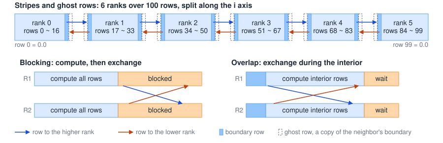

---
format:
  pdf:
    documentclass: article
    papersize: letter
    fontsize: 12pt
    geometry:
      - margin=1in
    include-in-header: preamble.tex
# Write cross-references as @tbl-name and @fig-name: whole-ref-links.lua makes
# the whole "Table 1" or "Figure 1" the link in the PDF, not just the number.
# drawio-svg.lua hides the "Text is not SVG" line draw.io adds to saved SVGs.
filters:
  - path: ../../templates/writeup/whole-ref-links.lua
    at: post-quarto
  - path: ../../templates/writeup/drawio-svg.lua
    at: pre-quarto
---

```{=latex}
% Fill these in once per assignment. They feed the first-page block,
% the running header (page 2 onward), and the footer.
% Name, last name, ID, and email are NOT set here. scripts/build-writeup.sh
% injects them at build time from .local/student.env, so they stay out of git.
\newcommand{\courseName}{CSS 534: Parallel Programming in Grid and Cloud}
\newcommand{\dueDate}{November 2, 2026}
\newcommand{\asgTitle}{Program 2: Parallelizing Wave Diffusion with MPI and OpenMP}
\newcommand{\codeRepo}{\url{https://github.com/GameAnimeCode/css534-parallel-programming}}

\thispagestyle{firstpage}
\noindent \stuName \hfill \courseName \\
\stuId{} | \stuEmail \hfill \dueDate

\bigskip
\begin{center}
{\Large\bfseries \asgTitle}
\end{center}
```

## 0. Abstract

> The Wave2D program simulates a 500-step wave propagating through a 588 x 588 water surface. I completed the sequential `Wave2D.cpp`, split the surface across MPI ranks in stripes, added OpenMP to the Schroedinger loop, and exchanged ghost rows using non-blocking calls while each rank computes its interior. On 6 CSSMPI nodes, the median times were 0.23s with 1 thread per rank and 0.11s with 4 threads per rank, compared to 1.10s on 1 rank. Using the same method as the handout, from each program's own 1 rank time, the speedups are 4.73 with 6 ranks (target 2.35) and 9.88 with 6 ranks and 4 threads (target 4.81). Relative to the professor's 2.16s, they are 9.27 and 19.34. Run side by side with the professor's binaries, the program was faster at every parallel setup tested.

## 1. Parallelization Strategy

### 1.1 MPI Stripes

> I divide the surface along the i-axis to create one stripe per rank, as illustrated in the upper portion of @fig-exchange. Since `size % mpi_size` rows remain, the first ranks each get one extra row, which gives the same ranges as the handout (`0 ~ 16` through `84 ~ 99` for 6 ranks). Each rank allocates the full `z[3][size][size]` and calculates only its own stripe.
>
> Because edge cells are always 0.0, it's a waste of time to compute them when t >= 2. The `stripe_begin` and `stripe_end` variables are offset by one position on rank 0 and the last rank. Additionally, `j` runs from 1 through `size - 2`, and the offset prevents the `i - 1` and `i + 1` rows from reading outside of the array.
>
> The three time levels rotate through `z[t % 3]`, so no values are copied.

### 1.2 Ghost Row Exchange

> Each cell needs its four neighbors from the previous step, so a rank needs one row from each neighboring rank. It keeps them in its ghost rows (`stripe_begin - 1` and `stripe_end + 1`).
>
> First, I compute the two boundary rows. Then, it posts `MPI_Irecv` and `MPI_Isend` to both neighbors. It computes the remaining rows in the middle, and finally, it waits until all communication is finished using `MPI_Waitall`. The interior only reads the two previous levels and can therefore run while the rows travel (@fig-exchange). None of the ranks will deadlock because the calls are non-blocking, so the ranks do not need an even and odd send order. Each neighbor still receives one row per step.
>
> The handout orders each step as print, exchange, compute. I changed this to exchange the rows computed in the same step. Since t = 0 and t = 1 for the entire surface are already computed by all ranks, it does not make sense to do an exchange before computing the first step, as it would transfer rows that every rank already has. Regardless of this change, there are 498 exchanges, as the last exchange in my order goes unused.
>
> I first wrote this as a blocking exchange after the compute. Section 3.5 covers why it changed.

{#fig-exchange width=100% fig-pos="H"}

### 1.3 Printing

> When a frame is due, `MPI_Gatherv` collects every stripe at rank 0, which uses `MPI_IN_PLACE` since its stripe is already in position. Rank 0 is the only rank that prints.

### 1.4 OpenMP

> The `#pragma omp parallel for` directive sits on the outer `i` loop of the formula, where the time is spent. Each iteration writes to its own row of `z_curr` and reads the two previous levels, so there is no need for locks or reductions. Since `compute_row` is passed row pointers, each thread can go through its own locals without indexing into the full array for every cell. The `j` loop remains serial. Only the main thread calls MPI, outside of the parallel region.

## 2. Source Code

### 2.1 `Wave2D_mpi.cpp`

```{=latex}
\begin{quote}\fontsize{8}{10}\selectfont
```

```cpp

```

```{=latex}
\end{quote}
```

### 2.2 `Wave2D.cpp`

> `Wave2D_mpi.cpp` started from this file, so the simulation loop is the part to show.

```{=latex}
\begin{quote}\fontsize{8}{10}\selectfont
```

```cpp
  for (int t = 2; t < max_time; t++)
  {
    const int t_prev = (t + 2) % 3;
    const int t_prev2 = (t + 1) % 3;

    if (interval != 0 && (t % interval == 0 || t == max_time - 1))
    {
      cout << t << endl;
      for (int j = 0; j < size; j++)
      {
        for (int i = 0; i < size; i++)
          cout << z[t % 3][i][j] << " ";
        cout << endl;
      }
      cout << endl;
    }

    for (int i = 1; i < size - 1; i++)
    {
      for (int j = 1; j < size - 1; j++)
      {
        z[(t + 3) % 3][i][j] =
            2.0 * z[t_prev][i][j] - z[t_prev2][i][j] +
            constant_mp_t2 * (z[t_prev][i + 1][j] + z[t_prev][i - 1][j] +
                              z[t_prev][i][j + 1] + z[t_prev][i][j - 1] -
                              4.0 * z[t_prev][i][j]);
      }
    }
  } // end of simulation
```

```{=latex}
\end{quote}
```

## 3. Execution Output

```{=latex}
\begin{quote}\vspace{-15pt}
```

::: {.callout-note title="Use of AI"}
I used AI to generate the benchmark scripts in `bench/`, which build the program variations tested here based on my code and instructions. I then ran these scripts on CSSMPI to collect the data and compile it into the tables and charts shown below.
:::

```{=latex}
\end{quote}
```

> All runs used 6 nodes, CSSMPI-12 through CSSMPI-17, where one node differs: CSSMPI-12 uses an Intel Xeon Platinum 8358P, while the others use a Xeon Gold 6248. Each node has 5 physical cores with 2 hyperthreads each, which gives 10 logical CPUs. The ranks landed on one node each. I used `g++` 11.5.0 as the compiler along with MPICH2 1.2.1p1. I compiled the files using `compile.sh` and saved the raw logs in `bench/results/` (on GitHub).

### 3.1 Output Comparison

> The handout's comparison on CSSMPI:

```{=latex}
\begin{quote}\fontsize{8}{10}\selectfont
```

```text

```

```{=latex}
\end{quote}
```

> @tbl-verify lists the wider comparisons, 35 in total. They include the professor's `out1.txt`, a size of 233 (which does not divide evenly and has a weight of 2) against the professor's `Wave2D`, and every variant used in this section.



### 3.2 Performance and Speedup

> @tbl-matrix includes every required scenario (ranks 1 to 6 and threads 1 to 4), as well as additional scenarios with 5, 6, and 8 threads, because the nodes have 5 cores instead of the 4 in the handout. CSSMPI is shared, so I report the median of 10 runs, and each round runs every pair once to distribute other users' load. @tbl-matrix-mean has the means of the same runs, which stay within about 0.02s of the medians. @tbl-speedup and @fig-matrix show the medians as speedup.



```{=latex}
\needspace{14\baselineskip}
```





::: {#fig-matrix fig-pos="H"}

```{=latex}
\pgfplotstableread[col sep=comma]{bench/results/summary/matrix.csv}\matrixtable
\pgfplotstableread[col sep=comma]{bench/results/summary/speedup.csv}\speeduptable
\begin{tikzpicture}
\begin{groupplot}[group style={group size=2 by 1, horizontal sep=1.6cm},
  width=0.5\linewidth, height=6cm, xmin=0.7, xmax=6.3, xtick={1,2,3,4,5,6}, grid=major, grid style={gray!25},
  xlabel={Ranks}, tick label style={font=\footnotesize}, label style={font=\small}]
\nextgroupplot[ylabel={Median time (s)}, ymin=0, ymax=1.3]
  \addplot[blue, thick, mark=*, mark size=1.5pt] table[x=ranks, y=t1]{\matrixtable};
  \addplot[orange, thick, mark=square*, mark size=1.5pt] table[x=ranks, y=t2]{\matrixtable};
  \addplot[teal, thick, mark=triangle*, mark size=1.8pt] table[x=ranks, y=t4]{\matrixtable};
  \addplot[purple, thick, mark=diamond*, mark size=1.8pt] table[x=ranks, y=t5]{\matrixtable};
  \addplot[gray, thick, mark=x, mark size=2pt] table[x=ranks, y=t8]{\matrixtable};
\nextgroupplot[ylabel={Speedup over 1 rank, 1 thread}, ymin=0, ymax=11, legend columns=2, legend style={font=\scriptsize, at={(0.5,1.03)}, anchor=south}]
  \addplot[blue, thick, mark=*, mark size=1.5pt] table[x=ranks, y=t1]{\speeduptable};
  \addplot[orange, thick, mark=square*, mark size=1.5pt] table[x=ranks, y=t2]{\speeduptable};
  \addplot[teal, thick, mark=triangle*, mark size=1.8pt] table[x=ranks, y=t4]{\speeduptable};
  \addplot[purple, thick, mark=diamond*, mark size=1.8pt] table[x=ranks, y=t5]{\speeduptable};
  \addplot[gray, thick, mark=x, mark size=2pt] table[x=ranks, y=t8]{\speeduptable};
  \legend{1 thread, 2 threads, 4 threads, 5 threads, 8 threads}
\end{groupplot}
\end{tikzpicture}
```

Median time and speedup by rank count.

:::

> @tbl-requirements assesses the results against the targets (vs own and handout numbers). Own divides the program's 1 rank, 1 thread median (1.10s), which is how the handout derived its targets from the professor's own times. Own produces 4.73 compared to 2.35 for 6 ranks, and 9.88 compared to 4.81 for 6 ranks and 4 threads. The professor's target used 2 threads, where the program achieves 7.14. Handout uses the professor's 2.16s as a base and gives 9.27 and 19.34. Wave2D divides the sequential median (1.92s) and gives 8.23 and 17.17.
>
> At 1 thread, times drop at every step, from 1.10s on 1 rank to 0.23s on 6. With threads, the times start to level off at around 0.11s from 5 ranks on. The fastest setup in the table is 6 ranks and 8 threads at 0.109s. 6 ranks outperform 1 rank at every thread count.
>
> Another user's job held one CPU on CSSMPI-12, which is rank 0's node, during these runs. This explains two results. The first is at 1 rank, where going from 4 threads to 5 raises the time from 0.31s to 0.42s. I ran a separate check of 5 runs each to confirm this: 5 threads took 0.43s on CSSMPI-12 and 0.24s on idle CSSMPI-15. The second is 10 threads, where each test took about 5.5s regardless of rank count, and the professor's binary did the same (5.61s against 5.53s at 6 ranks). 10 threads need all 10 logical CPUs, so the job leaves one thread sharing, and the rest likely spin waiting on it. To check this, I ran 3 runs each: 1 rank with 10 threads took 5.70s on CSSMPI-12 and 0.22s on CSSMPI-15, while 9 threads took 0.26s and 0.23s. Because the 10 thread runs show what that job does and not what the program does, I left them in `bench/results/runs.csv`, but they do not appear in the tables.
>
> 6 threads are slower than 8 on both nodes (0.38s and 0.33s at 1 rank). At 6 threads one core likely carries two threads, and the `static` split leaves the others waiting on them.



> @tbl-reference switches between the professor's binaries and mine within each round, so both see the same load. My program runs faster at every parallel setup, by both median and mean, and the sequential programs tie. The professor's binaries also run well under the handout's times here (0.54s versus 0.92s at 6 ranks), so the side by side results are the ones to compare.
>
> 1 rank of `Wave2D_mpi` (1.11s) is 42% faster than `Wave2D` (1.92s) because its loop reads through row pointers and `z_curr`, where `Wave2D` indexes the full array for every cell. The speedups in the Wave2D column of @tbl-requirements include this gain as well as the parallelism.



### 3.3 Where the Time Goes

> @tbl-phases and @fig-phases split each run into compute and the time blocked in the exchange, using `MPI_Wtime()` around each part. Setup, including t = 0 and t = 1, stays under 0.01s.
>
> Compute scales well, a drop of about 6 times from 1.11s to 0.19s at 6 ranks. Meanwhile, the exchange wait drops from 0.13s at 2 ranks to 0.04s at 6, so it remains near 19% of the run at 1 thread. At 6 ranks with 4 threads, the exchange wait was 0.03s against 0.06s of compute.



::: {#fig-phases fig-pos="H"}

```{=latex}
\pgfplotstableread[col sep=comma]{bench/results/summary/phases.csv}\phasetable
\begin{tikzpicture}
\begin{groupplot}[group style={group size=2 by 1, horizontal sep=1.6cm},
  width=0.5\linewidth, height=5.5cm, xtick=data,
  xticklabels from table={\phasetable}{ranks}, xlabel={Ranks}, ymin=0, grid=major, grid style={gray!25},
  tick label style={font=\footnotesize}, label style={font=\small}, title style={font=\small}]
\nextgroupplot[ybar stacked, bar width=11pt, title={1 thread}, ylabel={Seconds per rank}, ymax=1.3]
  \addplot[fill=blue!45] table[x=idx, y=c1]{\phasetable};
  \addplot[fill=orange!70] table[x=idx, y=e1]{\phasetable};
\nextgroupplot[ybar stacked, bar width=11pt, title={4 threads}, ymax=0.5, legend style={font=\scriptsize, at={(0.98,0.97)}, anchor=north east}]
  \addplot[fill=blue!45] table[x=idx, y=c4]{\phasetable};
  \addplot[fill=orange!70] table[x=idx, y=e4]{\phasetable};
  \legend{compute, exchange wait}
\end{groupplot}
\end{tikzpicture}
```

Compute and exchange wait per rank.

:::

### 3.4 OpenMP Overhead

> @tbl-noomp compares a build with the `omp` pragma removed against the normal build at 1 thread. Five of the six rows changed between -0.6% and +1.8%, with no discernible trend. Therefore, the 498 parallel regions per run add too little overhead to measure. 3 ranks increased by +22.3%. This table contains only 5 runs each, and an earlier full run had its one outlier at 6 ranks (+26.9%) with 3 ranks at +2.8%, so I read this as load on the shared cluster and not a cost of OpenMP.



### 3.5 Exchange Design

> My first version did a blocking exchange after the compute, where even ranks send first and odd ranks go left first. This made the swaps take two phases instead of a chain. Its compute was scaling; however, with row pointers making 1 rank fast, the wait limited its own speedups to 2.23 and 4.00, lower than both targets. @tbl-change shows that version against the final one, built from the same source and run in the same rounds. The times fall by 52% and 59%, and both speedups exceed their targets.



> @tbl-exchange-total and @tbl-exchange break down the change into its two parts. Async only keeps the compute together, and the blocking calls are replaced by the same `MPI_Isend`, `MPI_Irecv` and `MPI_Waitall`. This means that all four messages are sent at once rather than in two rounds. This accounts for 70% to 80% of the gain at 6 ranks. Computing the interior during the exchange contributes the rest. It makes the largest difference at 1 thread, where the interior is longest.





> The other rows evaluate my blocking design choices. "Before compute" uses the handout's step order, with my left first exchange. Each step first exchanges the boundary rows computed in the previous step, then computes, where my order computes and then exchanges the rows it just computed. The code is otherwise the same as left first, with the same message count and size. It is ahead of left first in 5 of the 6 columns, by 9% at most, which is well inside the 26% median spread between runs, so I based this decision on logic rather than speed.
>
> "Right first" makes the chain. I assumed left first would be the fastest, since it needs 4 steps at 6 ranks where right first needs 10 when a send must wait. However, right first was ahead in 4 of the 6 columns. This is likely because an `MPI_Send` of 4,704 bytes returns without waiting for the receive, so the chain does not form.

### 3.6 Sample Output

> One complete run with 6 ranks and 5 threads (the first matrix run, from the `bench/results/logs/` folder):

```{=latex}
\begin{quote}\fontsize{8}{10}\selectfont
```

```text
$ mpirun -np 6 ./Wave2D_mpi 588 500 0 5

```

```{=latex}
\end{quote}
```

## 4. Discussion

### 4.1 Parallelization

> The program reached 4.73 versus the 2.35 target and 9.88 versus 4.81 on its own 1 rank time. It was faster than the professor's binaries at every parallel setup tested. The compute parallelized as well as I had hoped, with 6 ranks cutting it by about 6 times, and threads on top of that. Skipping the edges for t >= 2 is a minor optimization, as it removes 2 out of 588 rows (about 0.3%) that would only ever hold 0.0.
>
> The largest lesson was that a faster program can have a worse speedup. Row pointers took 1 rank from 1.78s to 1.15s in a quick side by side test, and this lowered the speedups because the time at 6 ranks was mostly waiting on the exchange. Timing the compute and the exchange apart showed how much time the exchange took, so the main problem was the exchange and not the compute.

### 4.2 Limitations

> In order of impact:
>
> 1. The major limit continues to be the exchange wait. It is 19% of the total run at 2 ranks, 19% at 6 ranks and 35% at 6 ranks with 4 threads. More threads leave less interior to hide the wait behind, which is why times flatten near 0.11s. At 6 ranks, 4 and 8 threads take approximately the same time (0.112s and 0.109s). At 6 ranks with 1 thread, this wait is why the speedup is 4.73 and not the 5.87 that Amdahl's law predicts (see [Appendix A](#sec-amdahl)).
> 2. Hardware is the second limit. Threads past 5 share cores, and on idle CSSMPI-15 1 rank is 37% slower at 6 threads than at 5, when the `static` split is uneven.
> 3. CSSMPI is a shared cluster, so the network timing may vary. The slowest run of a configuration was a median of 26.3% above its fastest and up to 118.6% at worst, so close results here should not be over-read. One other job can also take a whole thread count out of use, as it did for 10 threads. The earlier full run was about 1.4 to 2 times slower at 6 ranks than this one, on the same nodes.
> 4. Each rank still computes t = 1 over the whole surface and holds the full array, but at under 0.01s this does not matter for time. It does limit the size, as `z[3][588][588]` barely fits in the 8 MiB stack.

### 4.3 Possible Improvements

> - **Exchange less often:** With 2 ghost rows per side, ranks could exchange every 2 steps, computing one extra row each time. Fewer exchanges mean fewer waits, so this is the change I would try next.
> - **Use `dynamic` scheduling:** Program 1 showed that chunks help once threads share cores, because the faster threads can pick up the slack. It could help at 6 threads here.
> - **Drop the last exchange:** Nothing reads it, but this saves only 1 of 498.

### 4.4 Reflections

> Conceptualizing the stripes and data communication was a bit more difficult than I had imagined. This might be because I'm slightly rusty and haven't dealt with parallelization in a few years, or perhaps because communicating boundaries and keeping a mental model of them is inherently tricky. Typical parallelization that doesn't involve breaking up and sharing data is much easier to reason about. Being thrown into new tech stacks was also slightly overwhelming, and it would be helpful to explore them more during the lab portion of the class.
> 
> Ultimately, I struggled to achieve the required performance metrics. At first, I thought this was due to chained blocking communication. However, even after fixing the potential chaining, I still wasn't getting satisfactory numbers. I finally decided to invest the time into implementing an async overlap pattern, which drastically increased performance. After speaking with other students, I wonder if I was just experiencing bad timing on the CSSMPI cluster; a day later, my results were significantly better, making me question if spending that extra time on the async overlap pattern was actually necessary.

## 5. Lab 2

> The lab parallelizes a serial matrix multiplication, `c = a * b`, by splitting the rows of `a` across MPI ranks.

### 5.1 Source Code

#### 5.1.1 `matrix_mpi.cpp`

> Rank 0 broadcasts the size, then sends each rank its stripe of `a` and all of `b`, since every row of `c` needs every row of `b`. Each rank multiplies its stripe and rank 0 collects the stripes of `c`.

```{=latex}
\begin{quote}\fontsize{9}{11}\selectfont
```

```cpp
  // broadcast the matrix size to all.
  MPI_Bcast(&size, 1, MPI_INT, 0, MPI_COMM_WORLD);

  int stripe = size / mpi_size; // partitioned stripe

  // master sends each partition of a[] to a different slave
  // master also sends b[] to all slaves
  if (my_rank == 0)
  {
    for (int rank = 1; rank < mpi_size; rank++)
    {
      double *a_stripe = a + stripe * size * rank;
      MPI_Send(a_stripe, stripe * size, MPI_DOUBLE, rank, 0, MPI_COMM_WORLD);
      MPI_Send(b, size * size, MPI_DOUBLE, rank, 0, MPI_COMM_WORLD);
    }
  }
  else
  {
    MPI_Recv(a, stripe * size, MPI_DOUBLE, 0, 0, MPI_COMM_WORLD, &status);
    MPI_Recv(b, size * size, MPI_DOUBLE, 0, 0, MPI_COMM_WORLD, &status);
  }

  // all ranks should compute multiplication
  multiplication(a, b, c, stripe, size);

  // master receives each partition of c[] from a different slave
  if (my_rank == 0)
  {
    for (int rank = 1; rank < mpi_size; rank++)
    {
      double *c_stripe = c + stripe * size * rank;
      MPI_Recv(c_stripe, stripe * size, MPI_DOUBLE, rank, 0, MPI_COMM_WORLD,
               &status);
    }
  }
  else
  {
    MPI_Send(c, stripe * size, MPI_DOUBLE, 0, 0, MPI_COMM_WORLD);
  }
```

```{=latex}
\end{quote}
```

### 5.2 Execution Output

> One run of each program on CSSMPI at size 480, on 1 to 4 ranks. Size 200 from `mpi_setup.txt` does not divide evenly by 3, so I used 240 and 480.

```{=latex}
\begin{quote}\fontsize{8}{10}\selectfont
```

```text
$ ./matrix 480
elapsed time = 500039

$ mpiexec -n 1 ./matrix_mpi 480
elapsed time = 496999

$ mpiexec -n 2 ./matrix_mpi 480
elapsed time = 279753

$ mpiexec -n 3 ./matrix_mpi 480
elapsed time = 245415

$ mpiexec -n 4 ./matrix_mpi 480
elapsed time = 207226
```

```{=latex}
\end{quote}
```

> A single run is noisy, so I repeated each setup 10 more times, alternating with the professor's binary (@tbl-lab).

|Size|Ranks|Median (ms)|Mean (ms)|Speedup|Professor (ms)|Speedup|
|--:|--:|--:|--:|--:|--:|--:|
|240|1|57.6|57.8|1.00|57.4|1.00|
|240|2|47.7|48.8|1.21|51.1|1.12|
|240|3|43.6|45.4|1.32|45.6|1.26|
|240|4|44.1|45.2|1.31|42.1|1.36|
|480|1|496.8|497.7|1.00|494.1|1.00|
|480|2|300.3|303.1|1.65|301.7|1.64|
|480|3|229.0|237.0|2.17|225.5|2.19|
|480|4|207.5|207.9|2.39|204.1|2.42|

: Lab 2 timings on CSSMPI. {#tbl-lab}

### 5.3 Comments

> The multiply alone scales well, from 495.6ms on 1 rank to 122.3ms on 4. The total does not, reaching 2.39 at size 480 and stopping near 1.3 at size 240.
>
> The gap is communication. Every rank gets all of `b`, so adding ranks does not shrink that transfer, and rank 0 spent 56.1ms distributing at size 480 on 4 ranks. Compute grows with the cube of the size and communication with the square, so the larger matrix gains more.

## Appendix A: Amdahl's Law Calculation {#sec-amdahl}

> Amdahl's law predicts the speedup on $N$ processors when a fraction $s$ of the run must stay serial and the rest divides evenly:
>
> $$S(N) = \frac{1}{s + \frac{1 - s}{N}}$$
>
> Only setup runs serially, including t = 0 and t = 1. It stays under 0.0049s of the 1.104s on 1 rank, so this is an upper bound on $s$:
>
> $$s = \frac{T_{\text{serial}}}{T_{\text{total}}} = \frac{0.0049}{1.104} \approx 0.0044$$
>
> At 6 ranks:
>
> $$S(6) = \frac{1}{0.0044 + \frac{0.9956}{6}} = \frac{1}{0.0044 + 0.1659} \approx 5.87$$
>
> With unlimited processors the parallel term goes to zero, which sets the ceiling:
>
> $$S(\infty) = \frac{1}{s} = \frac{1.104}{0.0049} \approx 225$$
>
> The measured speedup at 6 ranks is 4.73. Amdahl's law does not model communication, and compute alone reaches 5.95 (1.107s to 0.186s in @tbl-phases), so the exchange wait accounts for the gap.
